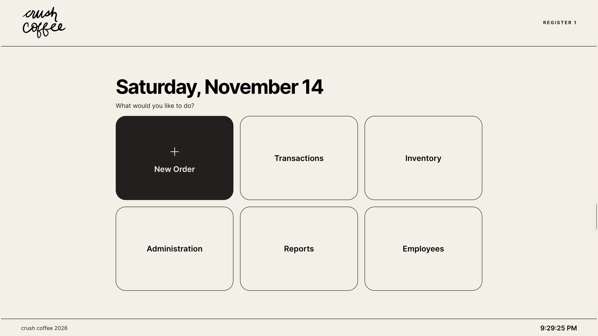
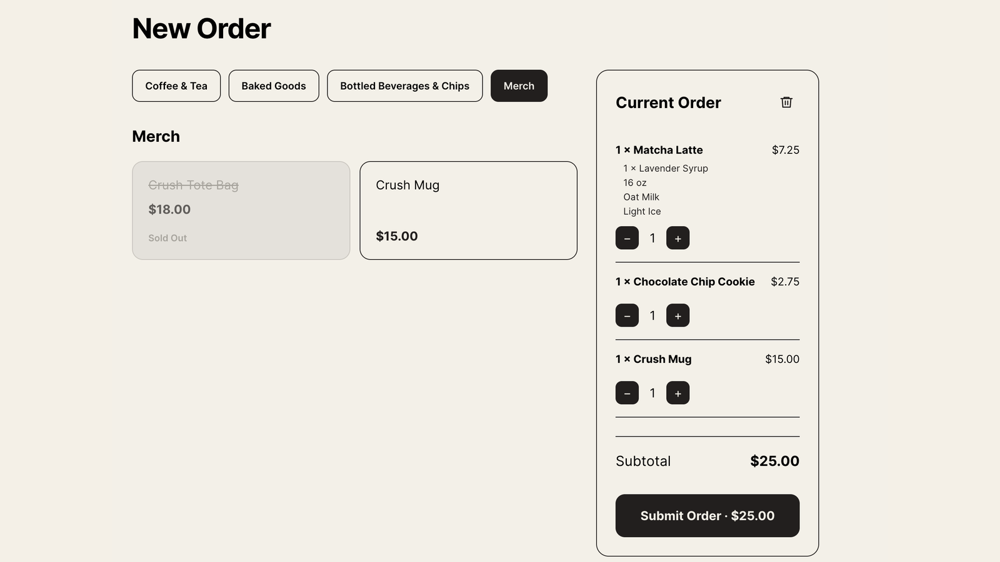
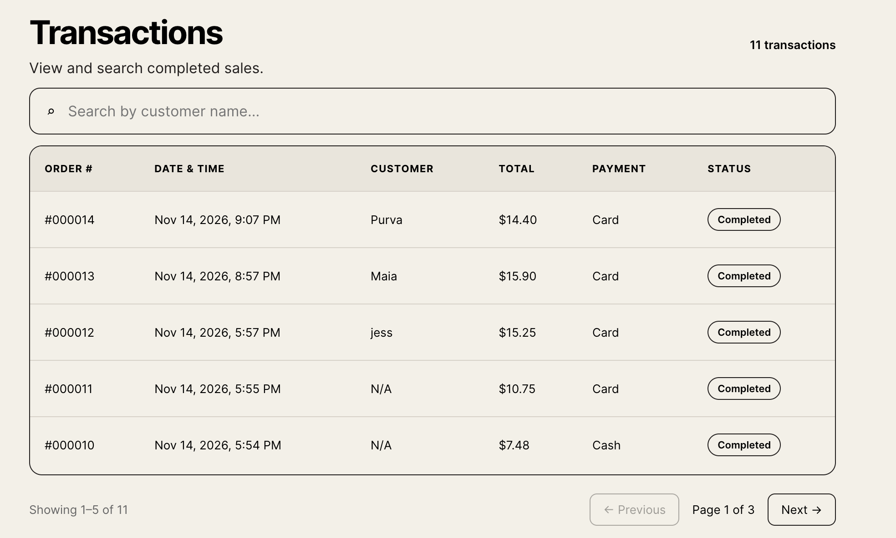
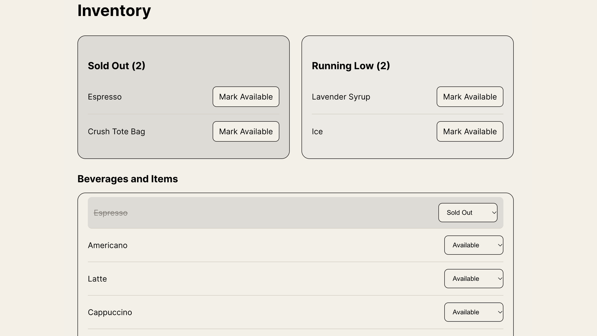
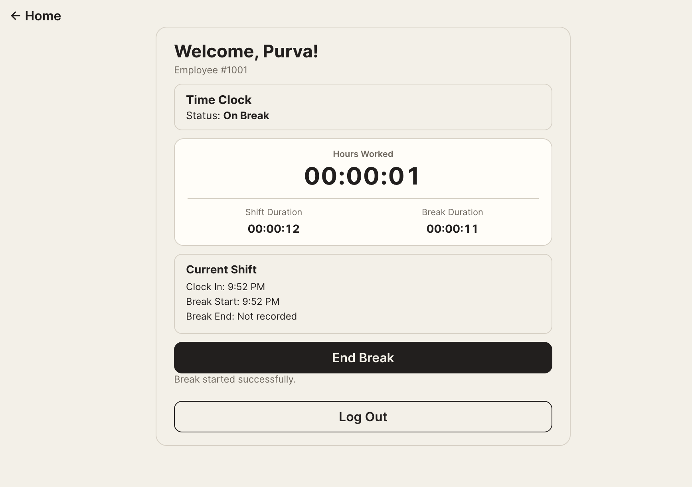
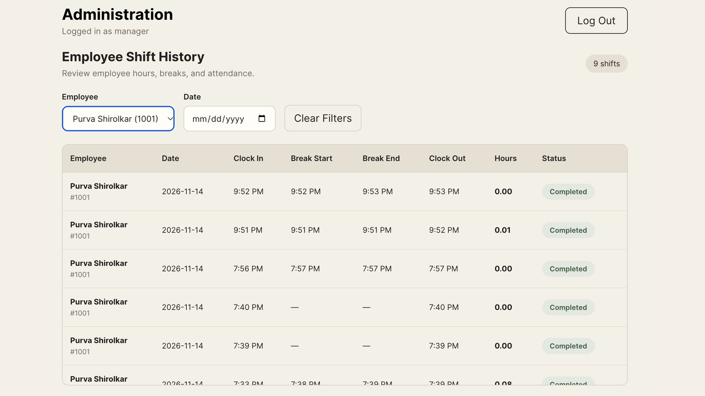
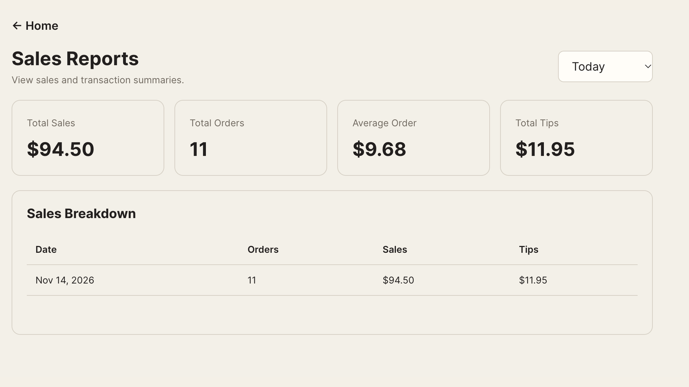

# Crush Coffee POS ☕

**A full-stack point-of-sale system for my make believe cafe**

Crush POS is a web-based point-of-sale application built with React, Node.js, Express, and PostgreSQL. It brings together order processing, transaction management, employee time tracking, and sales reporting in a single interface.

I built Crush POS to explore full-stack application development, relational database design, REST API development, and session-based authentication through a practical, real-world use case.......and because I LOVE coffee!

## Tech Stack

| Layer          | Technologies                 |
| -------------- | ---------------------------- |
| Frontend       | React, JavaScript, Vite, CSS |
| Backend        | Node.js, Express.js          |
| Database       | PostgreSQL                   |
| Authentication | bcrypt, express-session      |
| Development    | Git, GitHub, npm, VS Code    |

## Screenshots

### Home Screen



### Application Features

<table>
  <tr>
    <td width="50%" align="center">
      <strong>Point of Sale</strong>
      
    </td>
    <td width="50%" align="center">
      <strong>Transactions</strong>
      
    </td>
  </tr>
  <tr>
    <td align="center">
      <strong>Inventory</strong>
      
    </td>
    <td align="center">
      <strong>Employee Shift Tracking</strong>
      
    </td>
  </tr>
  <tr>
    <td align="center">
      <strong>Administration</strong>
      
    </td>
    <td align="center">
      <strong>Sales Reports</strong>
      
    </td>
  </tr>
</table>

## Features

### Point of Sale

- Create and manage customer orders
- Calculate subtotals, taxes, tips, and order totals
- Record cash and card payments
- Track pending and completed transactions

### Employee Time Tracking

- Employee authentication using hashed passwords
- Clock-in and clock-out functionality
- Break tracking with start and end times
- Active shift tracking and hours worked calculations

### Administration

- Separate administrator account and login interface
- Manager-only access to employee shift history
- Employee and date filtering
- Review shift times, breaks, and hours worked

### Sales Reports

- Daily, weekly, and monthly sales summaries
- Total sales, completed orders, and average order value
- Tip tracking
- Daily sales breakdowns generated from PostgreSQL queries

### Inventory

- Dedicated inventory interface for managing café products

## Application Architecture

Crush POS uses a three-layer architecture:

```text
React Frontend
      |
      | HTTP / REST API
      v
Node.js + Express Backend
      |
      | SQL Queries
      v
PostgreSQL Database
```

The React frontend handles the POS interface and communicates with the Express backend through REST API endpoints.

The backend manages application logic, database operations, authentication, and reporting.

PostgreSQL stores order records, employee accounts, shift history, and administrator credentials.

## Technical Implementation

**Authentication and Sessions**

Employee and administrator credentials are stored as bcrypt password hashes. Express sessions maintain authenticated login state, with protected backend routes for administrative shift history.

**Database Design**

PostgreSQL tables store orders, employees, administrators, and employee shifts. Foreign-key relationships associate shift records with employees, while database constraints help maintain valid time records.

**Sales Reporting**

SQL aggregation queries calculate sales totals, order counts, average order values, and tips. Reports include only paid, completed orders and use the America/New_York timezone for local business dates.

## Getting Started

### Prerequisites

- Node.js and npm
- PostgreSQL
- Git

### Installation

Clone the repository:

```bash
git clone https://github.com/pshirolk/crush.git
cd crush
```

Install backend dependencies:

```bash
cd backend
npm install
```

Install frontend dependencies:

```bash
cd ../frontend
npm install
```

### Environment Configuration

Create a `.env` file inside the `backend` directory and configure the PostgreSQL connection and session secret using the environment variables expected by the backend.

Database tables must be created before running the application. An automated database setup is not yet included.

### Running Locally

Start the backend:

```bash
cd backend
npm run dev
```

In a separate terminal, start the frontend:

```bash
cd frontend
npm run dev
```

The application runs locally at:

- Frontend: `http://localhost:5173`
- Backend: `http://localhost:5001`

## Project Status

**In active development.**

Core functionality for order processing, employee time tracking, administrator access, and sales reporting **has been implemented.**

Branding and additional improvements are ongoing.
